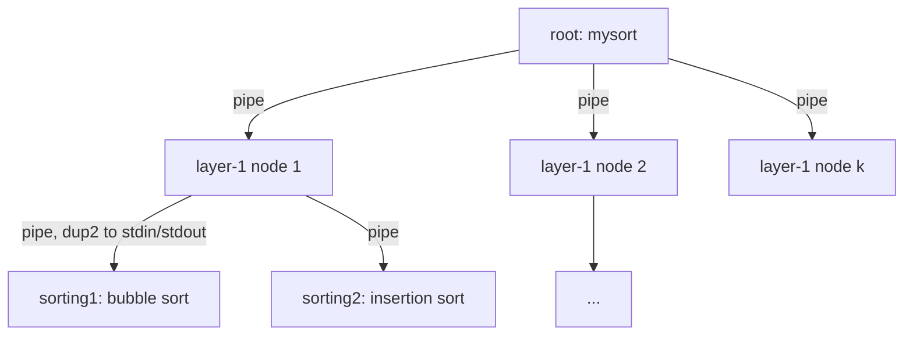

# Unix Processes & IPC in C

Two small systems that explore classic operating-system concepts: a **multi-process sorting tree** that communicates through pipes, and the **readers-writers problem** solved with POSIX semaphores in System V shared memory.

> Built for the *Operating Systems* course (Dept. of Informatics & Telecommunications, University of Athens, Fall 2023).

---

## 1. Parallel sort with a process tree ([`parallel-sort/`](parallel-sort))

Sorts a binary file of records (`custid, last name, first name, postcode`) by *last name → first name → id*, using a **two-level tree of processes**:



- The root reads the file and `fork()`s **k** layer-1 processes. Each one gets a slice of the records through a pipe.
- Each layer-1 node splits its slice again and `fork()`s sorter processes. They redirect `stdin`/`stdout` to the pipe with `dup2` and `exec` one of two **separate sorting executables**, alternating between bubble sort and insertion sort.
- Sorted chunks travel back up the tree and are **merged** (as in merge sort) at every level (`merge.c`).

```bash
cd parallel-sort
make
./mysort -i voters500.bin -k 3 -e1 sorting1 -e2 sorting2
```

## 2. Readers-writers with shared memory ([`readers-writers-shm/`](readers-writers-shm))

Several independent **reader** and **writer** processes access a binary file of bank accounts at the same time. They coordinate through a segment of **System V shared memory** that holds two **process-shared POSIX semaphores** and run-time statistics.

| Program | Role |
|---|---|
| `creator` | Creates the shared-memory segment (`shmget`), initializes the semaphores (`sem_init(..., pshared=1, ...)`) and prints the segment id |
| `reader -f <file> -l <id or range> -d <max_delay> -s <shmid>` | Reads records and prints the average balance. Multiple readers can work at the same time. |
| `writer -f <file> -l <id> -v <amount> -d <max_delay> -s <shmid>` | Gets exclusive access and adds `amount` to an account's balance |
| `purger -s <shmid>` | Prints the statistics, destroys the semaphores and removes the segment |

**Synchronization.** This is the classic readers-preference solution. A `mutex` semaphore protects the shared reader counter. The first reader to arrive locks `write_sem` and the last reader to leave unlocks it, so writers get exclusive access. Every process also records into shared memory how long it waited and how long it worked.

```bash
cd readers-writers-shm
make files
./creator                                   # -> "Created shared memory with memory id = <ID>"
./reader -f accounts50.bin -l 3 -d 2 -s <ID> &
./writer -f accounts50.bin -l 3 -v 5 -d 2 -s <ID>
./purger -s <ID>
```

```text
1.Finished Readers = 1
2.Average Reader Time = 1.000 sec
3.Finished Writers = 1
4.Average Writer Time = 3.000 sec
5.Max Waiting Time = 1.000 sec
6.Records Handled = 2
```

## Concepts demonstrated

`fork` / `exec` / `wait` · anonymous pipes and `dup2` · divide-and-conquer across processes · System V shared memory (`shmget`, `shmat`, `shmctl`) · process-shared POSIX semaphores · the readers-writers synchronization problem

## Author

**Giorgos Fragkakis** · [GitHub](https://github.com/fragk17)
